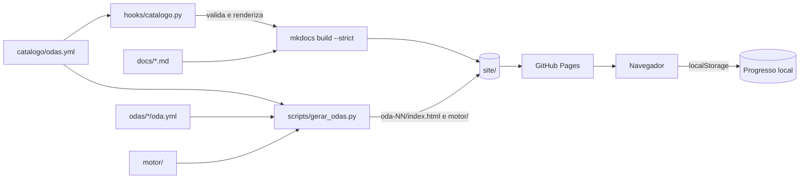
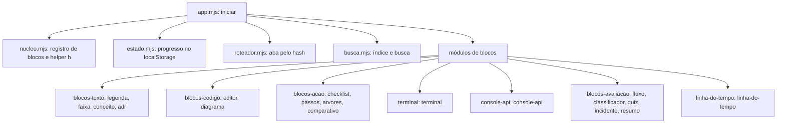

# Arquitetura e componentes

## Estrutura do repositório

| Caminho | Responsabilidade |
| --- | --- |
| `catalogo/odas.yml` | Fonte única do catálogo: repositórios com commit fixo, trilhas e as 36 ODAs com tempo, pré-requisitos, objetivo e situação |
| `odas/<oda>/oda.yml` | Conteúdo de uma ODA, organizado em sete abas de blocos |
| `hooks/catalogo.py` | Hook do MkDocs: valida o catálogo e substitui o marcador da página mestre pela tabela de ODAs |
| `scripts/gerar_odas.py` | Valida cada `oda.yml` e produz `site/<oda>/index.html`, além de copiar `motor/` para `site/motor/` |
| `motor/` | Motor das ODAs, em módulos ES, e a folha de estilo `oda.css` |
| `docs/` | Páginas do MkDocs (`index.md`, esta seção) e os ativos do portal: `assets/javascripts/oda/` e `assets/stylesheets/oda.css` |
| `tests/` | Testes de Python (`test_*.py`), de JavaScript (`js/`) e de navegador (`e2e/`) |
| `scripts/servidor_estatico.py` | Servidor HTTP estático usado pelo Playwright e para visualizar o resultado localmente |
| `.github/workflows/publicar.yml` | Esteira de testes, geração e publicação no GitHub Pages |

## Fluxo de dados

A construção acontece em duas etapas sequenciais sobre o mesmo diretório `site/`: primeiro o `mkdocs build --strict`, depois `gerar_odas.py --destino site`. A ordem é verificada por `tests/test_publicacao.py`, porque o MkDocs recria o diretório de saída e apagaria as ODAs geradas antes dele.

## Componentes da etapa de construção

### Hook do catálogo (`hooks/catalogo.py`)

- `validar_catalogo` confere campos obrigatórios, identificadores duplicados, existência da trilha e do repositório, faixa de 45 a 90 minutos, pré-requisitos com identificador menor (o que impede ciclos), coerência entre `situacao` e `app`, e existência do arquivo da aplicação.
- `renderizar_indice` produz o HTML da página mestre: um bloco por trilha, com tabela e totais de tempo. Todo texto vindo do catálogo passa por `html.escape`.
- `on_config` valida o catálogo e interrompe o build com `PluginError` se houver erro. `on_page_markdown` substitui o marcador `<!-- catalogo-odas -->` apenas em `index.md`.

### Gerador de ODAs (`scripts/gerar_odas.py`)

- `validar_oda` exige as sete abas, na ordem `missao`, `conceito`, `codigo`, `simulacao`, `laboratorio`, `diagnostico`, `verificacao`, e título igual ao do catálogo.
- `_bloco` valida cada bloco conforme a tabela `OBRIGATORIOS` (propriedades exigidas por tipo) e aplica regras específicas: legenda com no máximo três frases, anotações de editor dentro do trecho exibido, exatamente uma alternativa correta por pergunta, atores existentes na linha do tempo, comandos de cenário declarados no terminal, entre outras.
- `preparar` atribui a cada bloco o identificador `<aba>-<posição>`, usado por busca e ancoragem, e renomeia o `id` dos blocos `adr` e `diagrama` para `id_adr` e `id_diagrama`, que são identificadores de conteúdo.
- `html_da_oda` serializa a ODA como JSON dentro de `<script type="application/json">`, escapando `</` para impedir o fechamento antecipado da tag, e inclui o módulo `../motor/app.mjs`.

## Componentes da etapa de execução

### Motor das ODAs (`motor/`)

| Módulo | Contribuição |
| --- | --- |
| `app.mjs` | Ponto de entrada `iniciar(doc, win)`. Lê o JSON embutido, monta cabeçalho, abas, painéis, progresso, tema, modo foco e busca |
| `nucleo.mjs` | Registro `registrarBloco(tipo, renderizar)`, construtor de elementos `h`, `textoRico` (converte `` `código` `` em `<code>`), `renderizarBloco` com isolamento de falha e `avisar` |
| `estado.mjs` | `criarArmazenamento` (acesso tolerante a falha do `localStorage`) e `criarEstado` (abas concluídas, marcas e flags, com assinatura de mudanças) |
| `roteador.mjs` | Funções puras: `abaDoHash`, `vizinhas` e `progresso` |
| `busca.mjs` | Indexa todo o texto dos blocos, ignorando chaves técnicas (`tipo`, `origem`, `estilo`, `efeito`, `condicao`, `id`), e busca sem distinção de acento |
| `terminal.mjs` | Terminal simulado: resolve comandos declarados, aplica condições e efeitos, mantém histórico |
| `console-api.mjs` | Cenários de requisição e resposta HTTP, com status colorido |
| `linha-do-tempo.mjs` | `simular` calcula o status de cada evento (`entregue`, `retido`, `nao-ocorre`) conforme as falhas ativadas |

Os módulos de bloco se registram por efeito colateral de importação: `app.mjs` importa cada um, e cada arquivo chama `registrarBloco` no nível do módulo.

### Estado compartilhado entre blocos

O estado de uma ODA tem três conjuntos, todos gravados em `localStorage` sob a chave `oda-app:<id da ODA>`:

- **abas**: etapas marcadas como concluídas;
- **marcas**: caixas de verificação e resultado de quiz, por identificador de bloco;
- **flags**: nomes de estado ligados ou desligados pelos `efeito` de passos e comandos, que habilitam ou bloqueiam comandos do terminal por meio de `condicao`.

O tema escolhido fica na chave `oda-app:tema`. Se o armazenamento estiver indisponível, o estudo continua e o progresso deixa de ser gravado.

### Componentes da página mestre (`docs/assets/javascripts/oda/`)

| Arquivo | Contribuição |
| --- | --- |
| `index.mjs` | Inicia os componentes a cada navegação (usa `document$` do Material para navegação instantânea) e ativa as caixas de objetivos |
| `nucleo.mjs` | Registro de componentes (`registrar`), leitura da configuração JSON do elemento e `montarTodos`, que monta cada `
` |
| `progresso.mjs` | Grava o estado das caixas de objetivos sob a chave `oda:<caminho>:objetivo-<n>` |
| `componentes/filtro-catalogo.mjs` | Filtro por repositório e situação sobre as linhas da tabela do catálogo |

O núcleo da página mestre repete parte do código do núcleo do motor (`separarCodigo`, construtor de elementos, `textoRico`, armazenamento). As duas árvores são publicadas e carregadas em contextos distintos, e nenhum módulo é compartilhado entre elas.

## Implantação

O fluxo de trabalho `publicar.yml` executa, nesta ordem: testes Python, testes JavaScript, `mkdocs build --strict`, geração das ODAs, testes de navegador e, no passo seguinte, publicação do diretório `site/` no GitHub Pages. O job de publicação só começa se todos os passos anteriores terminarem sem erro.
